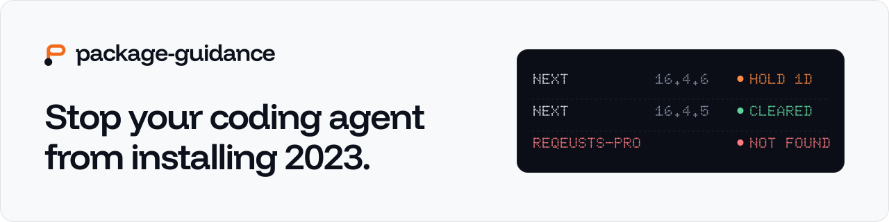
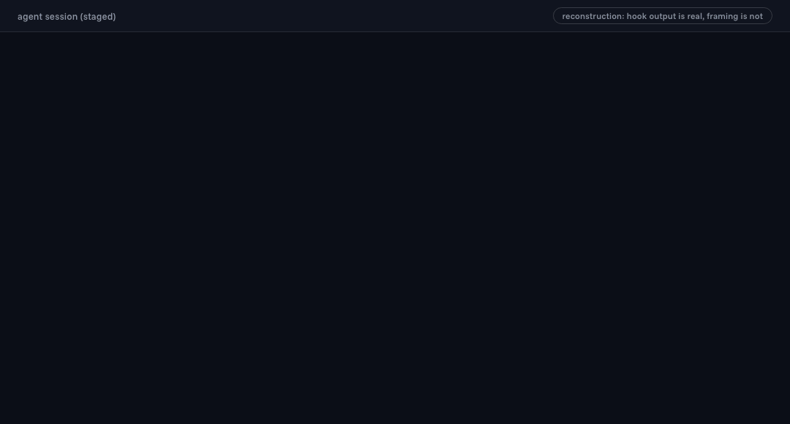

<picture>
  <source media="(prefers-color-scheme: dark)" srcset="brand/readme-banner-dark.svg">
  
</picture>

# package-guidance

[](https://github.com/harshpreet931/package-guidance/actions/workflows/ci.yml)
[](https://www.npmjs.com/package/package-guidance)
[](LICENSE)

[Website](https://harshpreet931.github.io/package-guidance/) · [Install](#install) · [Eval results](#does-it-work) · [How it works](docs/ARCHITECTURE.md)

Coding agents choose dependencies from memory, and their training data has stale majors, deprecated packages and package names that never existed. When they do reach for something current, they take the newest release, and that is exactly where supply-chain worms land.

`package-guidance` gives your agent a decision procedure backed by live registry data. It picks the right package, pins the newest *settled* version, and blocks hallucinated, deprecated, vulnerable and malicious installs before they happen.

<p align="center">
  
</p>
<p align="center"><sub>The hook's deny message is real output; the agent session around it is staged.</sub></p>

```sh
/plugin marketplace add harshpreet931/package-guidance   # Claude Code: skill + install hook,
/plugin install package-guidance@package-guidance        #   in two steps
npx skills add harshpreet931/package-guidance            # Codex, Cursor, Copilot, Gemini CLI, …
npx package-guidance harden --write                      # turn on your package manager's own cooldown
```

Or ask directly:

```
$ npx package-guidance check request moment tailwindcss@3 lodash@4.17.20 reqeusts-pro next

  package-guidance  npm · cooldown 7d

  ✗ request         deprecated   request has been deprecated since Feb 2020…
                                 use fetch (native), ky, ofetch · guide: request-to-fetch
  → moment          replace      Moment is a legacy project in maintenance mode…
                                 use date-fns, Temporal (native), dayjs · guide: moment-to-date-fns
  ! tailwindcss@3   outdated     Tailwind v4 is current (4.3.x).
                                 use tailwindcss@4, @tailwindcss/postcss · guide: tailwind-v4
  ✗ lodash@4.17.20  vulnerable   Use 4.18.1: 4.17.20 has 2 high/critical advisories.
  ✗ reqeusts-pro    not-found    Likely hallucinated: not on the npm registry.
  ✓ next            ok           16.4.5 · settled 12d
                                 16.4.6 was published 6d ago; holding at 16.4.5 until it settles.

  Install  npm install tailwindcss@4.3.5 lodash@4.18.1 next@16.4.5

  Blocked  request, reqeusts-pro  do not install; use the alternatives above
```

<sub>Real output from 2026-11-16, trimmed. Versions move daily; that is the point.</sub>

## Does it work?

We ran 124 real Claude Code sessions with Sonnet: 31 tasks, twice each, with and without package-guidance. An [independent scorer](evals/README.md) checked every resulting project against public npm, PyPI and OSV data only. It never uses this tool's code. These are the dependencies the agent added or changed:

| | Plain agent | With package-guidance |
|---|---:|---:|
| Versions installed less than 7 days after release | **39** | **0** |
| Versions with a known advisory (2 high/critical) | **7** | **0** |
| Tasks with zero dependency problems | 47% | **92%** |
| Problem dependencies per task | 1.08 | **0.15** |

Every difference above is significant at 95% (bootstrap CI over tasks). Hallucinated packages were zero in both arms on these tasks, so we make no claim there. Agent cost went from $0.15 to $0.18 per task.

A smarter model doesn't fix it either: in 15 tasks, **Claude Opus** on its own made 12 installs of releases under 7 days old and put 12 dependencies on outdated majors; with package-guidance, 0 and 0, and all 15 tasks were problem-free.

Access to live data isn't enough either. In a commands-only eval with **Kimi** (31 tasks × 2 runs per arm), we gave one arm a plain registry lookup tool that returns the latest version and its publish date. It changed almost nothing, because the model just pins whatever is latest:

| Kimi, deps it chose | Plain | + registry tool | + package-guidance |
|---|---:|---:|---:|
| Versions less than 7 days old | 49 | 48 | **0** |
| Versions with a known advisory | 5 | 1 | **0** |
| Answers with zero dependency problems | 42% | 40% | **97%** |

Reports: [`evals/published`](evals/published/). A GLM run is incomplete because of gateway failures.

## Why "latest" is not safe

Compromised releases are published *as* the latest version and usually live for hours before they are pulled. On September 8, 2025 the hijacked `chalk` 5.6.1 and `debug` 4.4.2 releases were downloadable for about two hours ([Wiz](https://www.wiz.io/blog/widespread-npm-supply-chain-attack-breaking-down-impact-scope-across-debug-chalk)). In November 2025 the self-replicating [Shai-Hulud 2.0](https://www.wiz.io/blog/shai-hulud-2-0-ongoing-supply-chain-attack) worm pushed malicious versions of hundreds of packages. An agent that runs `npm install x@latest` installs whatever was published a minute ago.

So the rule is **the newest version that has been public for at least the cooldown** (default 7 days), unless a newer release fixes an advisory. pnpm, npm, yarn, bun and uv can all enforce a release-age cooldown themselves. `package-guidance harden` sets it up for your repo, and the hook respects it.

## Install

**Claude Code** (skill + install hook):
```
/plugin marketplace add harshpreet931/package-guidance
/plugin install package-guidance@package-guidance
```

**Any agent that supports skills** (Claude Code, Codex, Cursor, Copilot, Gemini CLI, …):
```sh
npx skills add harshpreet931/package-guidance
```

**Anything else:** paste this into `AGENTS.md` / `CLAUDE.md` / `.cursor/rules`:
```md
## Dependencies
Before adding or upgrading any npm or PyPI package, run
`npx -y package-guidance@0.1.0 check <pkg>... --json` (add `--pypi` for Python) and install the
returned `install` command verbatim. Never install `not-found`, `deprecated`, `malicious` or
unfixed `vulnerable` packages, never guess a similar name, and never lower a configured
release-age cooldown.
```

## The decision procedure

1. **Need it?** Prefer the platform: `fetch`, `crypto.randomUUID()`, `structuredClone`, `node --env-file`, `zoneinfo`.
2. **Right package?** Not deprecated, sunset or superseded. Curated entries plus the [e18e module-replacements](https://github.com/es-tooling/module-replacements) dataset.
3. **Real package?** A registry 404 means a hallucination. Never install it, and never guess a similar name.
4. **Settled version.** The newest release at least `cooldown` days old; a newer one only if it fixes an advisory.
5. **No known advisories** on the pinned version ([OSV.dev](https://osv.dev), which includes malicious-package reports).
6. **Respect project policy.** Keep a configured cooldown. Never lower or bypass it.
7. **Pin exactly** and commit the lockfile.

## CLI

```sh
npx package-guidance check <pkg[@range]>...          # verdict + pinned install line
npx package-guidance check --pypi "pydantic<2" fastapi
npx package-guidance scan [dir]                      # audit package.json / pyproject.toml / requirements.txt
npx package-guidance guide [id | query]              # curated migration guides (tailwind-v4, eslint-flat-config, …)
npx package-guidance harden [dir] [--write]          # configure a release-age cooldown for this repo
```

Options: `--cooldown <days>`, `--json`, `--cwd <dir>`, `--no-cache`, `-v`. Exit codes: `0` ok, `1` something is blocked, `2` usage error, `3` internal error, `4` a registry or advisory lookup failed, so nothing was verified. `scan` works as a CI gate.

| Verdict | Meaning |
|---|---|
| `ok` | Install the pinned `version`. |
| `caution` | Installable, with a known risk worth reading. |
| `outdated` | The requested range is on an old major; `version` is the current one. |
| `replace` | Use one of `alternatives` (native APIs first). |
| `deprecated` | Deprecated on the registry or sunset by its maintainers. |
| `vulnerable` | High/critical advisories; `fixedIn` is the settled fix, if any. |
| `malicious` | OSV reports this release as malware. |
| `not-found` | The package, or that version, does not exist. Almost always a hallucination. |
| `young` / `unproven` | A brand-new or barely downloaded package. Confirm it is the real one. |

## The hook

The Claude Code plugin adds a `PreToolUse` hook on Bash. It parses `npm`/`pnpm`/`yarn`/`bun`/`npx`/`pip`/`uv`/`poetry` commands and:

- **denies** hallucinated, malicious, deprecated, known-vulnerable and curated "never use" packages, and unpinned installs whose latest release is inside the cooldown. The reason tells the agent exactly what to run instead.
- **adds context** for softer warnings, such as an old major or a lighter alternative.
- **never approves** anything, so your permission settings are untouched.
- **fails open**: a network error or timeout never blocks you.
- costs about 25 ms on Bash commands that install nothing.

Set `PACKAGE_GUIDANCE_HOOK=warn` to never deny, or `off` to disable it.

## Data sources

All public, no API keys required: [deps.dev](https://deps.dev) for versions, publish times and deprecations; the npm and PyPI registries for existence, install scripts and yanks; [OSV.dev](https://osv.dev) for advisories and malware; npm download counts; [e18e module-replacements](https://github.com/es-tooling/module-replacements) (MIT); and hand-curated entries in [`data/entries`](data/entries) with migration guides in [`guides`](guides). Every curated entry cites a primary source and a `last_verified` date. Responses are cached for an hour in `~/.cache/package-guidance`.

## FAQ

**Isn't this what Socket, Snyk and Dependabot do?** They are excellent, and they run *after* the choice: in CI, on a PR, or on a package the agent already picked. This runs *at the moment of choice*, inside the agent, and tells it what to pick instead. Use both.

**Why not just tell the agent to use `@latest`?** Because `@latest` is where compromised releases appear first. See above.

**Does it phone home?** No telemetry. The only network calls are the public registry and advisory lookups listed above.

**Do you follow your own advice?** Yes. The skill and hook run an exact pinned version of this tool, never `@latest`. Our GitHub Actions are pinned to commit SHAs and also respect the cooldown.

**Will it slow my agent down?** A `check` takes ~1 s cold and is near-instant from cache. The hook does nothing unless the command installs packages.

## Contributing

The most useful contributions are data: a package agents keep getting wrong, or a recommendation of ours that is wrong. See [CONTRIBUTING.md](CONTRIBUTING.md). Report security issues privately: [SECURITY.md](SECURITY.md).

## License

MIT. The vendored e18e module-replacements dataset is also MIT (see `data/e18e.json`).

